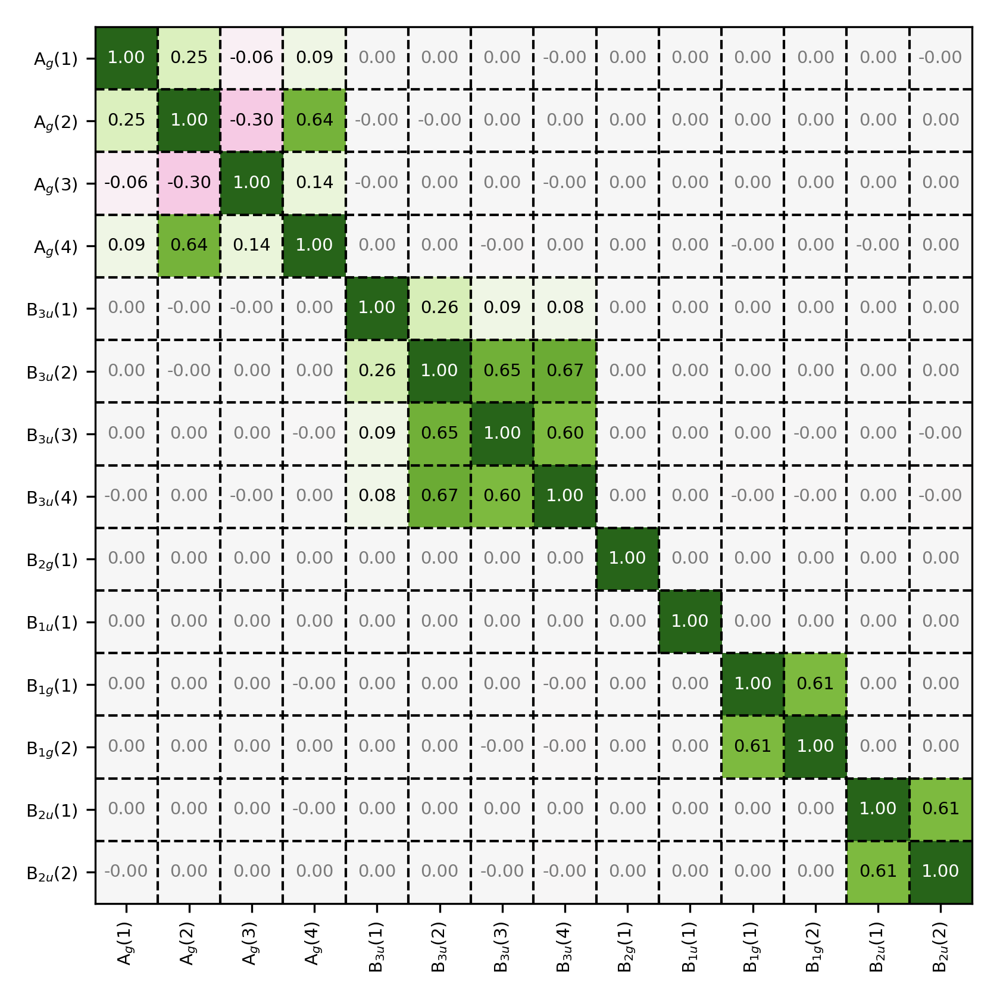
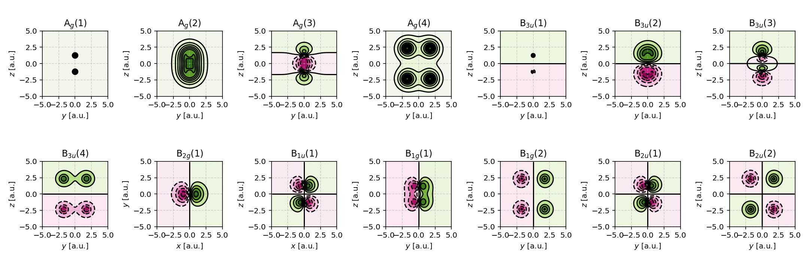
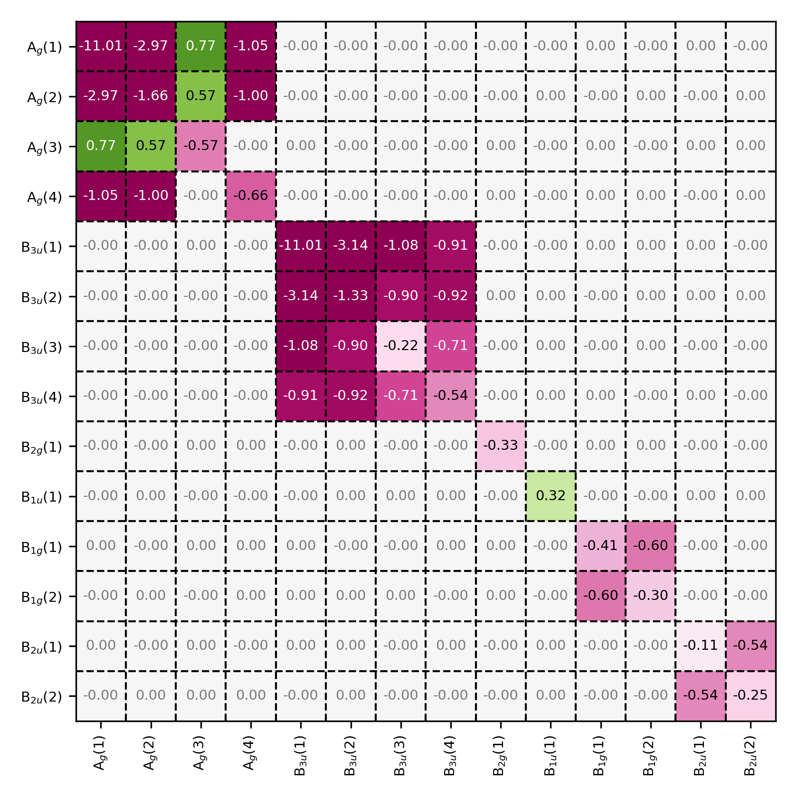
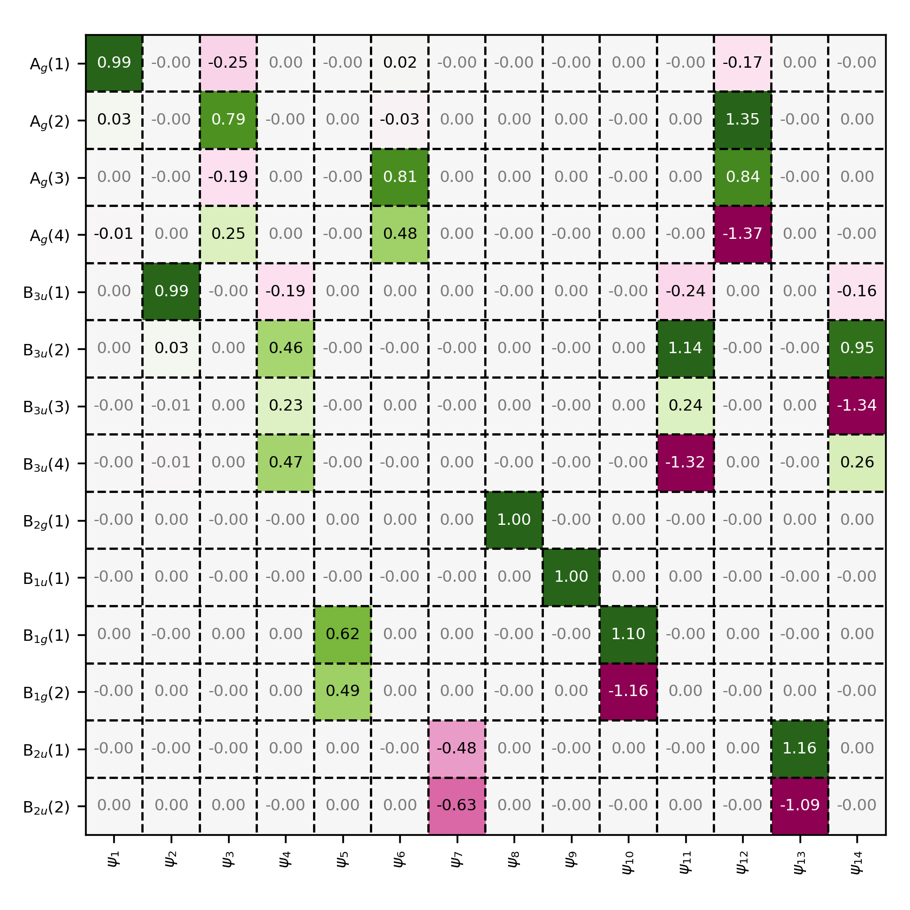

Symmetry-adapted basis sets
===========================

.. contents:: Table of Contents
   :depth: 3

This page describes an advanced workflow: constructing a *symmetry-adapted*
atomic-orbital basis (often called **SALCs**, symmetry-adapted linear
combinations) and using it to transform matrices such as the overlap and Fock
matrix into a **block-diagonal form** (one block per irreducible representation).

Why do this?
------------

For molecules with non-trivial point-group symmetry, a symmetry-adapted basis
can be used to:

- reveal the symmetry structure of the AO space,
- produce block-diagonal matrices (overlap, Fock, density),
- reduce computational cost by working per symmetry block,
- obtain orbitals that already carry irrep labels.

In :program:`PyQInt`, the Hartree-Fock driver accepts a packaged basis name or
a list of CGFs. For symmetry-adapted calculations, it is often useful to:

1. run a standard Hartree-Fock calculation to obtain matrices in the AO basis,
2. build a symmetry-adapted transformation matrix :math:`\mathbf{B}`,
3. transform matrices into the symmetry basis,
4. optionally reorder the symmetry basis to group irreps into consecutive blocks,
5. construct and visualize the resulting SALC basis functions.

.. note::

   The example below focuses on (i) constructing SALCs and (ii) transforming
   matrices into a symmetry basis. A full SCF implementation *in the symmetry
   basis* (i.e. performing the SCF iterations per symmetry block) is a natural
   extension, but is not currently exposed as a separate high-level workflow.

For geometric derivatives, each primitive follows the nucleus at its center.
The derivatives include the change in normalization of each multicenter
contraction. The Gaussian exponents and SALC coefficients are held fixed during
the displacement.

Building SALCs from an AO basis
-------------------------------

Pass existing CGFs and a real coefficient matrix to :code:`build_salcs`.
Each row specifies one SALC, and each column refers to an AO in the order
returned by :code:`mol.build_basis`. This H₂ example bundles the symmetric
and antisymmetric combinations of the two STO-3G 1s functions.

.. code-block:: python

    from pyqint import HF, MoleculeBuilder, build_salcs

    mol = MoleculeBuilder.from_name("h2")
    aos, _ = mol.build_basis("sto3g")
    salcs = build_salcs(aos, [[1, 1], [1, -1]], labels=["σg", "σu"])
    result = HF(mol, salcs.cgfs).rhf()

The returned :code:`SALCBasis` contains :code:`cgfs`, optional :code:`labels`,
and :code:`transform`, the effective coefficients after normalizing each
combination. Use :code:`salcs.transform @ S_ao @ salcs.transform.T` to express
an AO overlap matrix in this normalized basis. The same transformation
applies to other one-electron matrices. Rectangular transformations can
select a subset of combinations. The labels follow the supplied row order.

The helper combines the normalized source CGFs, including custom
contractions, and preserves their primitive centers and small nonzero
weights. It reports zero or cancelled rows by index and label when available.
Normalization applies to each combination individually. Mutual
orthogonality depends on the supplied combinations and the AO overlaps.

Ethylene example
----------------

The ethylene script uses a full transformation for the STO-3G basis, groups
SALCs by their overlap blocks, and plots matrices in the normalized basis.

.. literalinclude:: scripts/ethylene_symad.py
    :language: python

Results for ethylene
--------------------

    Overlap matrix in the symmetry-adapted basis. Observe that the overlap
    matrix has a block-diagonal structures, showing that the basis functions
    only overlap with other basis functions belonging to the same symmetry
    group.

    Contour plots of the symmetry adapted basis set. Note that the B3u and
    B2u basis functions constitute 2px orbitals are therefore cannot be
    visualized via a projection onto the :math:`yz`-plane.

    Fock matrix in the symmetry-adapted basis. Observe that the Fock matrix
    also has a block-diagonal structure.

    Coefficient matrix in the symmetry-adapted basis. All molecular orbitals are
    constructed from basis functions that belong to the same symmetry group.

.. note::

    - The transformation matrix :math:`\mathbf{B}` is **system- and ordering-dependent**.
      In production workflows it is typically derived from the character table and
      projection operators for the molecule's point group.

    - Integral evaluation uses the individual GTO centers preserved by
      :code:`build_salcs`.

    - The reordering step uses a simple heuristic based on the transformed overlap
      matrix. For rigorous work, irrep assignment should be based on the explicit
      symmetry operations of the point group.
